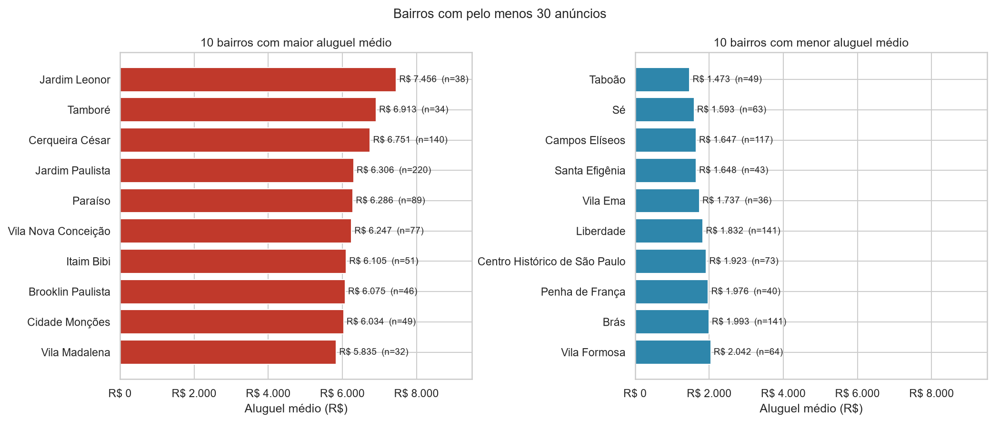

# 📊 Desafio Inicial SYNAPTA 2026 — Análise de Preços de Aluguel em São Paulo

**Candidato:** Henrique Leandro Ramos Silva  
**Matrícula:** 01907072  
**Curso / Período:** Bacharelado em Ciência da Computação (2º Período) — UNINASSAU Maceió  
**Opção Escolhida:** Opção 1 — Análise de preços de aluguel em São Paulo  
**Supervisão:** Coordenação SYNAPTA — Profa. Vitória Lo-Ruama Gonçalves Freire  

---

## 🎯 1. Problema e Pergunta Orientadora

O mercado de locação residencial na cidade de São Paulo é caracterizado por forte heterogeneidade socioespacial e estrutural. O objetivo deste projeto é investigar empiricamente como atributos físicos (área útil, número de quartos, vagas de garagem e tipologia construtiva) e a localização geográfica (distrito/bairro) se associam aos valores anunciados de aluguel e ao custo total mensal de moradia.

> **Pergunta orientadora:** *"Quais características parecem acompanhar os maiores e os menores preços de aluguel e o que os dados não permitem concluir?"*

---

## 📂 2. Fonte dos Dados e Descrição das Colunas

* **Dataset Oficial no Kaggle:** [Sao Paulo Housing Prices](https://www.kaggle.com/datasets/renatosn/sao-paulo-housing-prices)
* **Arquivo Principal:** `data.csv`
* **Volume Inicial:** **11.657 linhas** (imóveis anunciados) e **8 colunas**.

### Dicionário de Variáveis Originais (Descritas com palavras próprias)

| Coluna | Tipo | Descrição Funcional |
| :--- | :---: | :--- |
| `address` | Texto (`string`) | Logradouro (rua, avenida, alameda ou travessa) onde o imóvel está situado, sem o número predial. |
| `district` | Texto (`string`) | Bairro ou distrito da região metropolitana/capital onde o imóvel se localiza (1.199 localidades distintas). |
| `area` | Inteiro (`int64`) | Área útil ou construída do imóvel expressa em metros quadrados ($	ext{m}^2$). |
| `bedrooms` | Inteiro (`int64`) | Quantidade de dormitórios (quartos) disponíveis no imóvel. |
| `garage` | Inteiro (`int64`) | Número de vagas de estacionamento/garagem vinculadas ao imóvel. |
| `type` | Texto (`string`) | Categoria construtiva do imóvel: *Apartamento*, *Casa*, *Studio e kitnet* ou *Casa em condomínio*. |
| `rent` | Inteiro (`int64`) | Valor mensal anunciado exclusivamente para a locação do imóvel (em Reais — R$), sem taxas adicionais. |
| `total` | Inteiro (`int64`) | Despesa mensal total estimada para o inquilino (em Reais — R$), somando aluguel base, taxa de condomínio, IPTU e seguro incêndio. |

### Variáveis Criadas na Análise (Engenharia de Atributos)
Para tornar a comparação entre imóveis pequenos e grandes mais justa, foram calculadas três métricas auxiliares:
1. **`encargos` (`total - rent`):** Valor mensal em R$ referente às taxas adicionais (condomínio + IPTU).
2. **`peso_encargos_pct` (`(encargos / rent) * 100`):** Percentual que as taxas adicionais representam sobre o valor do aluguel base.
3. **`preco_m2` (`rent / area`):** Valor do aluguel mensal por metro quadrado ($	ext{R\$/m}^2$).

---

## 🛠️ 3. Ferramentas e Tecnologias Empregadas

* **Python 3.11:** Linguagem principal para auditoria, limpeza, agregação estatística e visualização reprodutível.
* **Pandas & NumPy:** Manipulação tabular, filtragem de inconsistências, agrupamentos (`groupby`) e cálculos de correlação.
* **Matplotlib & Seaborn:** Construção dos gráficos estatísticos padronizados em alta resolução (`150 DPI`).
* **Jupyter Notebook / Google Colab:** Ambiente interativo documentando código e raciocínio passo a passo.

---

## 🚀 4. Passo a Passo para Executar o Projeto

1. **Clonar este repositório:**
   ```bash
   git clone https://github.com/Henri742/Desafio-SYNAPTA-Henrique-Ramos.git
   cd Desafio-SYNAPTA-Henrique-Ramos
   ```
2. **Baixar o dataset original:**
   * Acesse [Sao Paulo Housing Prices no Kaggle](https://www.kaggle.com/datasets/renatosn/sao-paulo-housing-prices), baixe o arquivo `data.csv` e coloque-o na pasta raiz do projeto (veja detalhes em `data/COMO_BAIXAR_OS_DADOS.md`).
3. **Instalar as dependências:**
   ```bash
   pip install -r requirements.txt
   ```
4. **Executar a análise:**
   * Para rodar o script completo no terminal:
     ```bash
     python analise_alugueis_sp.py
     ```
   * Ou abra o arquivo `analise_alugueis_sp.ipynb` no VS Code, JupyterLab ou Google Colab.

---

## 🧹 5. Auditoria, Limpeza e Preparação dos Dados

Antes de calcular indicadores, a base bruta (`11.657 linhas x 8 colunas`) passou por uma verificação estrutural rigorosa:

1. **Valores Ausentes (`NaN`) e Duplicatas Exatas:**
   * Não foram encontrados valores nulos (`0` células vazias em todas as 8 colunas) nem linhas 100% idênticas (`0` duplicatas exatas).
2. **Inconsistências Físicas de Área (`area < 10 m²` — 7 registros):**
   * Foram detectados **2 imóveis com área igual a 0 $	ext{m}^2$** (na Rua Relíquia e na Rua Edmundo de Amicis) e **5 imóveis com área entre 1 $	ext{m}^2$ e 5 $	ext{m}^2$** (incluindo uma casa em condomínio no *Jardim dos Estados* registrada com **1 $	ext{m}^2$, 4 quartos, 3 vagas e aluguel de R$ 8.500**, além de um studio no *Butantã* com **1 $	ext{m}^2$ e 1 vaga**). Como o código de obras e a realidade física inviabilizam moradias com menos de $10	ext{ m}^2$, esses **7 registros foram removidos** para não distorcerem o cálculo de preço por metro quadrado.
3. **Imóveis com Zero Quartos (`bedrooms == 0` — 37 registros):**
   * Ao cruzar a coluna `bedrooms == 0` com o tipo de imóvel (`type`), verificou-se que **26 registros são do tipo `Studio e kitnet`**, nos quais a planta em conceito aberto (sem parede divisória para dormitório) torna o preenchimento `0 quartos` perfeitamente plausível.
   * Entretanto, **11 registros eram classificados como `Apartamento` (7) ou `Casa` (4)** com zero quartos. Esses **11 registros inconsistentes foram removidos**, enquanto os 26 *Studios* foram preservados.
4. **Resultado da Limpeza:**
   * Foram removidos ao todo **18 registros inconsistentes** ($0,15\%$ do total), consolidando uma base limpa e validada com **11.639 imóveis**.

---

## 📈 6. Resultados Estatísticos e Visualizações

### 6.1. Preço Médio vs. Preço Mediano dos Aluguéis

| Métrica | Aluguel Base (`rent` — Base Bruta) | Aluguel Base (`rent` — Base Limpa) | Custo Total (`total` — Base Limpa) |
| :--- | :---: | :---: | :---: |
| **Quantidade de Imóveis** | 11.657 | 11.639 | 11.639 |
| **Preço Médio** | R$ 3.250,81 | **R$ 3.250,50** | **R$ 4.080,27** |
| **Preço Mediano** | R$ 2.415,00 | **R$ 2.420,00** | **R$ 3.057,00** |
| **Desvio Padrão** | R$ 2.650,71 | R$ 2.649,28 | R$ 3.351,91 |
| **Mínimo / Máximo** | R$ 500 / R$ 25.000 | R$ 500 / R$ 25.000 | R$ 509 / R$ 28.700 |

**Por que a Média (R$ 3.250,50) e a Mediana (R$ 2.420,00) são tão diferentes?**  
A **mediana** divide a amostra exatamente ao meio: $50\%$ dos imóveis em São Paulo custam até R$ 2.420,00. Já a **média** soma todos os valores e divide pelo total de imóveis, sendo fortemente influenciada por valores extremos (*outliers*). Como existem mansões e apartamentos de luxo anunciados por até R$ 25.000,00 (enquanto nenhum aluguel pode ser menor que zero), forma-se uma **assimetria positiva (cauda longa à direita)** que puxa a média **R$ 830,50 (+34,3%) para cima da mediana**. Por isso, a mediana retrata melhor o imóvel "típico" paulistano.


---

### 6.2. Localidades com Maiores e Menores Preços Médios (Amostra $\ge 30$ registros)

Na base completa existem 1.199 bairros, mas centenas possuem apenas 1 a 5 anúncios (por exemplo, *Jardim Tango* tem apenas 1 imóvel anunciado por R$ 15.000). Em cumprimento ao edital (*"utilizando apenas grupos com quantidade razoável de registros"*), aplicou-se o critério mínimo de **30 imóveis por bairro ($n \ge 30$)**, garantindo representatividade estatística:

#### Top 10 Bairros com Maiores Preços Médios ($n \ge 30$)

| Posição | Bairro (`district`) | Qtd. Imóveis | Aluguel Médio | Aluguel Mediano | Área Mediana | Mediana R$/m² |
| :---: | :--- | :---: | :---: | :---: | :---: | :---: |
| **1º** | **Jardim Leonor** | 38 | **R$ 7.455,74** | R$ 7.428,00 | 167,5 m² | R$ 38,73/m² |
| **2º** | **Tamboré** | 34 | **R$ 6.912,68** | R$ 6.550,00 | 113,0 m² | R$ 59,48/m² |
| **3º** | **Cerqueira César** | 140 | **R$ 6.750,66** | R$ 5.925,00 | 92,0 m² | R$ 65,90/m² |
| **4º** | **Jardim Paulista** | 220 | **R$ 6.305,96** | R$ 5.000,00 | 90,0 m² | R$ 63,68/m² |
| **5º** | **Paraíso** | 89 | **R$ 6.285,56** | R$ 4.571,00 | 96,0 m² | R$ 55,83/m² |
| **6º** | **Vila Nova Conceição** | 77 | **R$ 6.246,77** | R$ 4.850,00 | 70,0 m² | R$ 77,25/m² |
| **7º** | **Itaim Bibi** | 51 | **R$ 6.105,29** | R$ 5.000,00 | 70,0 m² | **R$ 83,33/m²** |
| **8º** | **Brooklin Paulista** | 46 | **R$ 6.074,67** | R$ 4.550,00 | 114,0 m² | R$ 46,63/m² |
| **9º** | **Cidade Monções** | 49 | **R$ 6.034,27** | R$ 4.500,00 | 65,0 m² | R$ 74,40/m² |
| **10º** | **Vila Madalena** | 32 | **R$ 5.835,31** | R$ 4.125,00 | 71,5 m² | R$ 67,06/m² |

#### Top 10 Bairros com Menores Preços Médios ($n \ge 30$)

| Posição | Bairro (`district`) | Qtd. Imóveis | Aluguel Médio | Aluguel Mediano | Área Mediana | Mediana R$/m² |
| :---: | :--- | :---: | :---: | :---: | :---: | :---: |
| **1º** | **Taboão** | 49 | **R$ 1.473,14** | R$ 1.250,00 | 52,0 m² | R$ 23,11/m² |
| **2º** | **Sé** | 63 | **R$ 1.593,30** | R$ 1.400,00 | 40,0 m² | R$ 30,65/m² |
| **3º** | **Campos Elíseos** | 117 | **R$ 1.646,79** | R$ 1.550,00 | 40,0 m² | R$ 33,23/m² |
| **4º** | **Santa Efigênia** | 43 | **R$ 1.647,53** | R$ 1.390,00 | 42,0 m² | R$ 32,33/m² |
| **5º** | **Vila Ema** | 36 | **R$ 1.736,86** | R$ 1.575,00 | 50,5 m² | R$ 32,32/m² |
| **6º** | **Liberdade** | 141 | **R$ 1.831,74** | R$ 1.700,00 | 40,0 m² | R$ 40,89/m² |
| **7º** | **Centro Histórico de SP** | 73 | **R$ 1.923,47** | R$ 1.600,00 | 42,0 m² | R$ 36,85/m² |
| **8º** | **Penha de França** | 40 | **R$ 1.975,82** | R$ 1.700,00 | 51,5 m² | R$ 33,52/m² |
| **9º** | **Brás** | 141 | **R$ 1.992,66** | R$ 1.836,00 | 43,0 m² | R$ 44,44/m² |
| **10º** | **Vila Formosa** | 64 | **R$ 2.041,92** | R$ 1.725,00 | 49,0 m² | R$ 34,83/m² |



---

### 6.3. Comparação do Valor do Aluguel com Área, Quartos, Vagas e Tipo de Imóvel

1. **Relação com a Área (`area`):** Apresenta a maior correlação linear positiva com o aluguel ($r = 0,667$). À medida que a metragem aumenta, o valor médio do aluguel cresce de forma consistente, mas a dispersão também se amplia (um imóvel de $100	ext{ m}^2$ pode custar R$ 2.000 na periferia ou R$ 12.000 em bairro nobre).
2. **Relação com Vagas de Garagem (`garage`) e Quartos (`bedrooms`):** O número de vagas de garagem tem correlação mais forte com o preço ($r = 0,617$) do que o próprio número de quartos ($r = 0,531$). Após a limpeza dos erros cadastrais, a progressão de preço por número de dormitórios é perfeitamente monotônica de 0 (Studio) até 5 quartos:

| Quartos | Qtd. Imóveis | Área Média | Aluguel Médio | Aluguel Mediano |
| :---: | :---: | :---: | :---: | :---: |
| **0 (Studio)** | 26 | 30,9 m² | R$ 1.541,96 | R$ 1.253,50 |
| **1 quarto** | 4.190 | 40,6 m² | R$ 2.154,62 | R$ 1.714,50 |
| **2 quartos** | 4.345 | 70,5 m² | R$ 2.749,60 | R$ 2.200,00 |
| **3 quartos** | 2.422 | 138,7 m² | R$ 4.795,90 | R$ 3.800,00 |
| **4 quartos** | 542 | 249,8 m² | R$ 7.804,99 | R$ 7.115,00 |
| **5 quartos** | 91 | 322,7 m² | R$ 8.568,25 | R$ 8.000,00 |
| **6 quartos** | 23 | 331,4 m² | R$ 8.346,30 | R$ 8.000,00 |


3. **Custo Total e Preço por $	ext{m}^2$ segundo o Tipo de Imóvel:**

| Tipo de Imóvel | Qtd. | Aluguel Mediano | Encargos Medianos (`total - rent`) | Total Mediano | Preço Mediano / m² |
| :--- | :---: | :---: | :---: | :---: | :---: |
| **Apartamento** | 7.186 | R$ 2.500,00 | **R$ 775,50 (+30,3%)** | **R$ 3.296,00** | R$ 41,60/m² |
| **Casa** | 2.833 | R$ 2.600,00 | R$ 193,00 (+8,1%) | R$ 2.842,00 | R$ 24,67/m² |
| **Casa em condomínio** | 240 | R$ 2.200,00 | R$ 302,00 (+12,2%) | R$ 2.681,00 | R$ 31,25/m² |
| **Studio e kitnet** | 1.380 | R$ 1.848,00 | R$ 488,00 (+24,2%) | R$ 2.318,00 | **R$ 61,11/m²** |


---

## 💡 7. Cinco Conclusões Objetivas Apoiadas nos Dados

1. **Forte desigualdade e assimetria positiva nos preços:** Enquanto metade dos imóveis anunciados tem aluguel de até **R$ 2.420,00** (mediana), os imóveis de alto padrão (até R$ 25.000,00) elevam a média geral para **R$ 3.250,50** (+34,3% acima da mediana).
2. **Duas dinâmicas distintas nos bairros mais caros (Metragem vs. Valorização do $	ext{m}^2$):** Bairros residenciais arborizados como *Jardim Leonor* lideram a média nominal (**R$ 7.455,74**) porque ofertam mansões amplas (mediana de $167,5	ext{ m}^2$, custando R$ 38,73/$	ext{m}^2$). Já os polos financeiros como *Itaim Bibi* (**R$ 83,33/$	ext{m}^2$**) e *Vila Nova Conceição* (**R$ 77,25/$	ext{m}^2$**) possuem o metro quadrado mais caro da cidade em imóveis bem mais compactos ($70	ext{ m}^2$).
3. **O paradoxo dos Studios e Kitnets (menor boleto total, porém o $	ext{m}^2$ mais caro):** Embora apresentem o menor aluguel mediano (**R$ 1.848,00**), os *Studios e kitnets* cobram **R$ 61,11 por $	ext{m}^2$** — mais do que o dobro do metro quadrado de uma *Casa* (**R$ 24,67/$	ext{m}^2$**), refletindo sua alta concentração nas zonas centrais e corporativas.
4. **O peso decisivo do condomínio nos Apartamentos:** Em apartamentos, as taxas adicionais (`total - rent`) somam mediana de **R$ 775,50/mês** (+30,3% sobre o aluguel). Isso faz com que um apartamento com aluguel mediano menor (R$ 2.500) resulte num boleto final **R$ 454,00 mais caro** (**R$ 3.296,00**) do que uma casa de rua com aluguel base de R$ 2.600 (**R$ 2.842,00** no total).
5. **Capacidade de garagem e área superam o número de quartos na formação do preço:** O coeficiente de correlação mostra que a área útil ($r = 0,667$) e as vagas de garagem ($r = 0,617$) acompanham mais fortemente a elevação dos preços do que a simples contagem de quartos ($r = 0,531$), havendo um salto expressivo de preço a partir do 3º dormitório (mediana salta de R$ 2.200 para R$ 3.800).

---

## 🧭 8. Resposta à Pergunta Orientadora e Limitações da Análise

### Quais características parecem acompanhar os maiores e os menores preços de aluguel?
* **Maiores preços:** Estão fortemente associados à **combinação entre localização no eixo Sudoeste/Centro-Sul** (*Jardim Leonor, Cerqueira César, Jardim Paulista, Itaim Bibi, Vila Nova Conceição*), **ampla metragem útil ($> 100	ext{ m}^2$)**, **presença de 2 ou mais vagas de garagem** e **3 a 5 dormitórios**. No recorte de preço relativo ($	ext{R\$/m}^2$), os maiores valores acompanham *Studios* e apartamentos compactos próximos aos polos financeiros.
* **Menores preços:** Acompanham imóveis com **0 ou 1 quarto**, **ausência de vaga de garagem** (mediana de R$ 1.530,00 para imóveis sem garagem contra R$ 2.448,00 com 1 vaga) e localização em **bairros periféricos** (*Taboão, Vila Ema, Penha de França*) ou em **zonas antigas do Centro** com predomínio de quitinetes compactas (*Sé, Santa Efigênia, Campos Elíseos*).

### O que os dados NÃO permitem concluir? (Limitações)
1. **Estado de conservação, idade e padrão de acabamento:** O dataset não informa se o imóvel é recém-construído, reformado, mobiliado ou se apresenta problemas estruturais — fatores que explicam por que dois apartamentos do mesmo tamanho e na mesma rua têm preços muito diferentes.
2. **Infraestrutura do prédio e do entorno imediato:** Não há variáveis sobre lazer do condomínio (piscina, academia, portaria 24h), andar do apartamento, incidência solar, ruído urbano, segurança pública da rua ou distância exata até estações de metrô.
3. **Ausência de quantidade de banheiros e suítes:** A base não discrimina o número de banheiros ou suítes, atributo fundamental na precificação de imóveis de médio e alto padrão.
4. **Diferença entre preço anunciado e valor efetivamente contratado:** Os registros refletem o *asking price* (preço pedido no anúncio), não o valor final fechado após negociação ou descontos, além de estarem sujeitos ao viés de seleção da plataforma de anúncios e a um retrato estático no tempo (sem série histórica).

---

## 🤖 9. Declaração de Uso de Inteligência Artificial Generativa

Em conformidade com os itens 3 e 4 do Comunicado nº 1/2026 da SYNAPTA, declaro que a ferramenta de Inteligência Artificial Generativa (**Google Gemini**) foi utilizada como assistente de produtividade e revisão técnica nas seguintes frentes:

* **Finalidade do uso:** Apoio na estruturação do script Python (`pandas`, `matplotlib`, `seaborn`) para geração padronizada dos gráficos, organização da estrutura de pastas do repositório e revisão ortográfica/textual do relatório.
* **Como os resultados foram verificados pelo candidato:**
  1. Todos os cálculos de média, mediana, desvio padrão, contagens de linhas e filtros de bairros ($n \ge 30$) foram auditados e conferidos diretamente sobre o arquivo `data.csv` por meio de execução local do código e inspeção das tabelas geradas.
  2. Os casos extremos identificados (como os 7 imóveis com área $< 10	ext{ m}^2$ e a distinção entre os 26 *Studios* e os 11 apartamentos/casas com `bedrooms == 0`) foram inspecionados linha a linha na base original para validar a coerência das regras de negócio antes da exclusão.
  3. As interpretações analíticas, conclusões e limitações foram integralmente compreendidas, revisadas e validadas pelo autor para apresentação e defesa técnica na etapa de entrevista.
