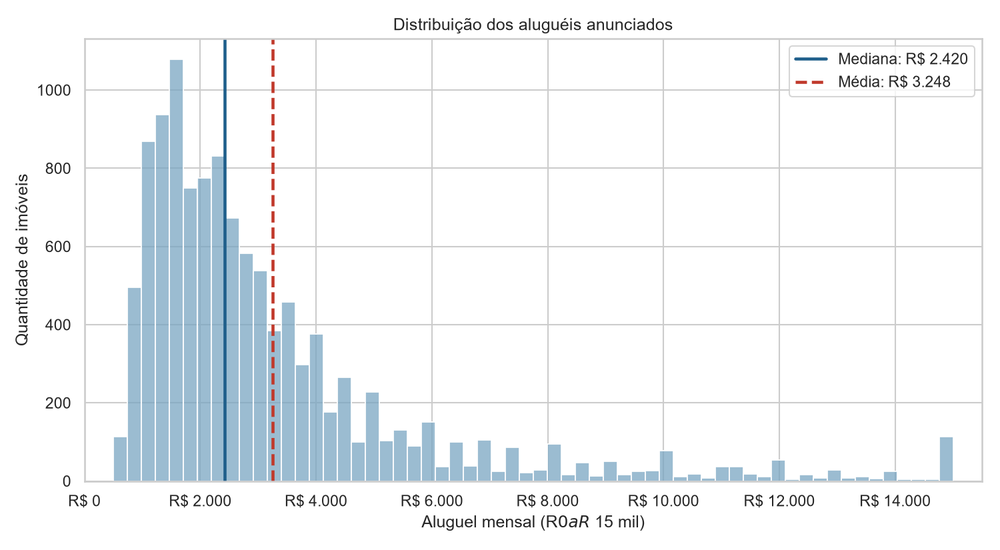
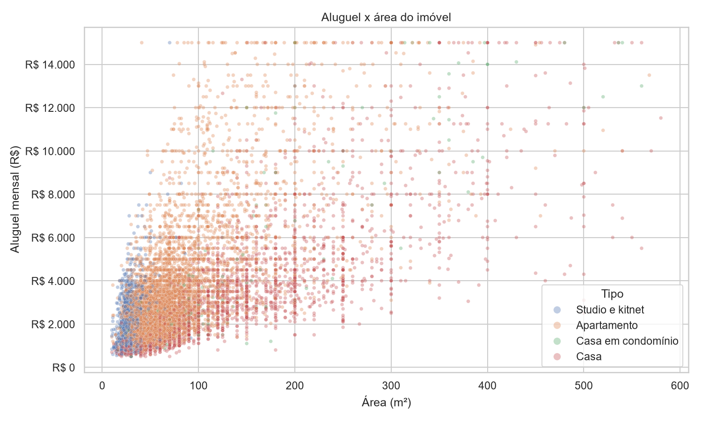
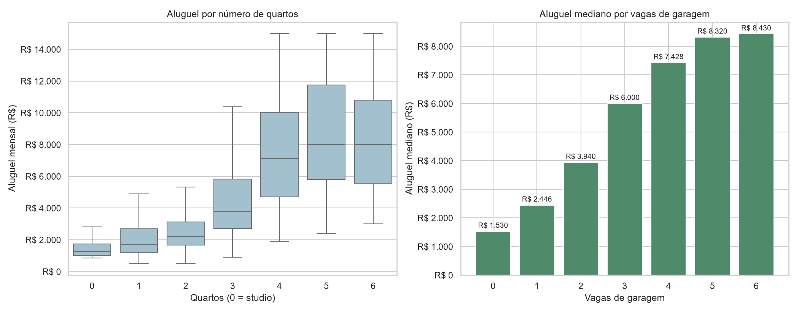
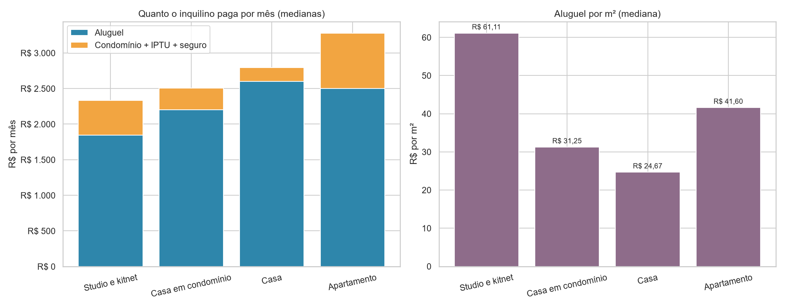

# Aluguel em São Paulo: o que acompanha os preços mais altos e mais baixos

Desafio inicial SYNAPTA 2026 - Opção 1 (análise de preços de aluguel em São Paulo)

- **Candidato:** Henrique Leandro Ramos Silva
- **Matrícula:** 01907072
- **Curso:** Ciência da Computação, 2º período - UNINASSAU Maceió

## Pergunta que guiou a análise

> Quais características parecem acompanhar os maiores e os menores preços de aluguel, e o que os dados não permitem concluir?

A ideia foi olhar para localização, área, quartos, vagas e tipo de imóvel e ver quais deles andam junto com o valor do aluguel. Não fiz previsão nem modelo, só análise descritiva.

## Dados

- **Fonte:** [Sao Paulo Housing Prices (Kaggle)](https://www.kaggle.com/datasets/renatosn/sao-paulo-housing-prices)
- **Arquivo usado:** `data.csv`
- **Tamanho original:** 11.657 linhas e 8 colunas

O dataset não está no repositório. Para baixar, veja [data/COMO_BAIXAR_OS_DADOS.md](data/COMO_BAIXAR_OS_DADOS.md).

### O que cada coluna significa

| Coluna | O que é |
| :--- | :--- |
| `address` | Rua do imóvel. Vem digitada de formas diferentes (às vezes com número, CEP ou abreviação). |
| `district` | Bairro. São 1.199 bairros diferentes, e alguns ficam fora da capital (Tamboré, por exemplo, é em Barueri). |
| `area` | Área do imóvel em m². |
| `bedrooms` | Número de quartos. |
| `garage` | Número de vagas de garagem. |
| `type` | Tipo: Apartamento, Casa, Casa em condomínio ou Studio e kitnet. |
| `rent` | Valor do aluguel anunciado, em reais, sem taxas. |
| `total` | Aluguel somado a condomínio, IPTU e seguro incêndio. É o que o inquilino paga de fato por mês. |

Também criei duas colunas para comparar melhor:

- `encargos = total - rent` → quanto se paga além do aluguel;
- `preco_m2 = rent / area` → aluguel por metro quadrado, para comparar imóvel pequeno com imóvel grande.

## Ferramentas

- Python 3.12
- pandas (leitura, limpeza e agrupamentos)
- matplotlib e seaborn (gráficos)
- openpyxl (exportar as tabelas para Excel)
- Jupyter Notebook

## Como executar

1. Clone o repositório:
   ```bash
   git clone https://github.com/Henri742/Desafio-SYNAPTA-Henrique-Ramos.git
   cd Desafio-SYNAPTA-Henrique-Ramos
   ```
2. Baixe o `data.csv` do Kaggle e coloque dentro da pasta `data/`.
3. Instale as bibliotecas:
   ```bash
   pip install -r requirements.txt
   ```
4. Rode a análise de um destes jeitos:
   - `python analise_alugueis_sp.py` (gera os gráficos em `graficos/` e as tabelas em `resultados/tabelas_resumo.xlsx`)
   - ou abra `analise_alugueis_sp.ipynb` no Jupyter, VS Code ou Google Colab. O notebook já está salvo com as saídas, então dá para ler sem executar.

### Estrutura

```
analise_alugueis_sp.ipynb   notebook com a análise e as saídas
analise_alugueis_sp.py      mesmo código em script
graficos/                   imagens usadas neste README
resultados/                 tabelas finais em Excel
data/                       onde colocar o data.csv
requirements.txt
```

## Limpeza dos dados

Primeiro conferi se havia problema na base antes de calcular qualquer coisa.

**Valores ausentes:** nenhum. Todas as 8 colunas estão completas.

**Linhas repetidas:** nenhuma linha é idêntica. Mas, como o endereço é digitado de formas diferentes, comparei também as linhas ignorando a coluna `address` e apareceram **5 pares** iguais em todo o resto. Olhando um por um, são o mesmo anúncio com o endereço escrito diferente, por exemplo:

- "Rua Evans" e "R. Evans, São Paulo - Sp, 03648-020, Brasil" (Vila Matilde, 40 m², R$ 1.600)
- "Avenida César Magnani" e "Avenida Cézar Magnani" (Paulicéia, 15 m², R$ 800)
- "Rua Fiandeiras" e "Rua das Fiandeiras" (Vila Olímpia, 40 m², R$ 2.300)

Removi a segunda cópia de cada par (5 linhas).

**Área impossível:** 7 imóveis têm menos de 10 m². Dois aparecem com 0 m² e os outros entre 1 e 5 m². O caso mais claro é uma casa em condomínio no Jardim dos Estados com **1 m², 4 quartos, 3 vagas e aluguel de R$ 8.500**. Não existe moradia assim, então é erro de digitação. Removi os 7.

**Zero quartos:** 37 imóveis têm `bedrooms = 0`. Separando por tipo:

| Tipo | Quantos | Decisão |
| :--- | :---: | :--- |
| Studio e kitnet | 26 | Mantidos. Studio costuma não ter quarto separado, então 0 faz sentido. |
| Apartamento | 7 | Removidos. Apartamento sem nenhum quarto não é plausível. |
| Casa | 4 | Removidos, pelo mesmo motivo. |

**Preço por m² absurdo:** calculei o aluguel por m² de cada imóvel. O normal vai até uns R$ 370/m², mas 3 anúncios passam de R$ 700/m²: um studio de 24 m² por **R$ 25.000** (o único aluguel acima de R$ 15.000 em toda a base), uma casa de 15 m² por R$ 15.000 e um apartamento de 12 m² por R$ 9.136. Provavelmente é zero a mais ou área errada. Removi os 3.

**Outras verificações que não exigiram mudança:** nenhum `total` menor que o `rent`, nenhum aluguel negativo ou zerado (o menor é R$ 500). Os outros aluguéis altos foram mantidos, porque batem com imóveis grandes em bairros caros.

**Um detalhe estranho:** 113 anúncios têm aluguel de exatamente R$ 15.000 e, tirando o studio acima, nenhum passa disso. Parece um limite do site de onde os dados vieram (ou da coleta). Mantive esses imóveis, mas isso quer dizer que os imóveis mais caros provavelmente estão "cortados" em R$ 15.000.

**Resultado:** saíram 26 linhas (0,2% da base) e a análise segue com **11.631 imóveis**.

## Resultados

### 1. Média e mediana do aluguel

| | Base original | Base limpa | Total mensal (base limpa) |
| :--- | :---: | :---: | :---: |
| Imóveis | 11.657 | 11.631 | 11.631 |
| Média | R$ 3.250,81 | **R$ 3.247,74** | R$ 4.077,64 |
| Mediana | R$ 2.415,00 | **R$ 2.420,00** | R$ 3.057,00 |
| Menor / maior | R$ 500 / R$ 25.000 | R$ 500 / R$ 15.000 | R$ 509 / R$ 28.700 |

A limpeza quase não mexeu nesses números, o que mostra que os erros eram poucos.

A **mediana** é o valor do meio: metade dos imóveis tem aluguel de até R$ 2.420. A **média** soma tudo e divide pelo total, então sente muito o efeito de poucos imóveis caríssimos. Como o aluguel não desce abaixo de R$ 500 mas sobe até R$ 15.000, esses valores altos puxam a média para cima: ela fica **R$ 828 (34%) acima da mediana**. Dá para ver isso no gráfico abaixo:



*A maioria dos anúncios fica entre R$ 1.000 e R$ 4.000 e depois vem uma "cauda" longa para a direita. A linha tracejada (média) fica deslocada para a direita da linha contínua (mediana) justamente por causa dessa cauda. Por isso, para falar do aluguel "típico", a mediana representa melhor.*

### 2. Bairros mais caros e mais baratos

Muitos bairros têm só 1 ou 2 anúncios, e aí um único imóvel de luxo já coloca o bairro no topo. Por isso usei só os bairros com **pelo menos 30 anúncios**, o que deixa 78 bairros na comparação.


*Cada barra é o aluguel médio do bairro e o "n" é a quantidade de anúncios. Os mais caros pagam cerca de 4 a 5 vezes o que se paga nos mais baratos.*

**Mais caros**

| | Bairro | Anúncios | Aluguel médio | Aluguel mediano | Área mediana | R$/m² mediano |
| :---: | :--- | :---: | :---: | :---: | :---: | :---: |
| 1 | Jardim Leonor | 38 | R$ 7.455,74 | R$ 7.428 | 167,5 m² | R$ 38,73 |
| 2 | Tamboré | 34 | R$ 6.912,68 | R$ 6.550 | 113 m² | R$ 59,48 |
| 3 | Cerqueira César | 140 | R$ 6.750,66 | R$ 5.925 | 92 m² | R$ 65,90 |
| 4 | Jardim Paulista | 220 | R$ 6.305,96 | R$ 5.000 | 90 m² | R$ 63,68 |
| 5 | Paraíso | 89 | R$ 6.285,56 | R$ 4.571 | 96 m² | R$ 55,83 |
| 6 | Vila Nova Conceição | 77 | R$ 6.246,77 | R$ 4.850 | 70 m² | R$ 77,25 |
| 7 | Itaim Bibi | 51 | R$ 6.105,29 | R$ 5.000 | 70 m² | R$ 83,33 |
| 8 | Brooklin Paulista | 46 | R$ 6.074,67 | R$ 4.550 | 114 m² | R$ 46,63 |
| 9 | Cidade Monções | 49 | R$ 6.034,27 | R$ 4.500 | 65 m² | R$ 74,40 |
| 10 | Vila Madalena | 32 | R$ 5.835,31 | R$ 4.125 | 71,5 m² | R$ 67,06 |

**Mais baratos**

| | Bairro | Anúncios | Aluguel médio | Aluguel mediano | Área mediana | R$/m² mediano |
| :---: | :--- | :---: | :---: | :---: | :---: | :---: |
| 1 | Taboão | 49 | R$ 1.473,14 | R$ 1.250 | 52 m² | R$ 23,11 |
| 2 | Sé | 63 | R$ 1.593,30 | R$ 1.400 | 40 m² | R$ 30,65 |
| 3 | Campos Elíseos | 117 | R$ 1.646,79 | R$ 1.550 | 40 m² | R$ 33,23 |
| 4 | Santa Efigênia | 43 | R$ 1.647,53 | R$ 1.390 | 42 m² | R$ 32,33 |
| 5 | Vila Ema | 36 | R$ 1.736,86 | R$ 1.575 | 50,5 m² | R$ 32,32 |
| 6 | Liberdade | 141 | R$ 1.831,74 | R$ 1.700 | 40 m² | R$ 40,89 |
| 7 | Centro Histórico de São Paulo | 73 | R$ 1.923,47 | R$ 1.600 | 42 m² | R$ 36,85 |
| 8 | Penha de França | 40 | R$ 1.975,82 | R$ 1.700 | 51,5 m² | R$ 33,52 |
| 9 | Brás | 141 | R$ 1.992,66 | R$ 1.836 | 43 m² | R$ 44,44 |
| 10 | Vila Formosa | 64 | R$ 2.041,92 | R$ 1.725 | 49 m² | R$ 34,83 |

Uma coisa que chamou atenção: o topo da lista não é caro sempre pelo mesmo motivo. O Jardim Leonor lidera porque os imóveis são grandes (mediana de 167,5 m²), mas o m² lá custa R$ 38,73. Já no Itaim Bibi e na Vila Nova Conceição os imóveis têm metade do tamanho (70 m²) e o m² passa de R$ 77. Ou seja, num caso o preço vem do tamanho, no outro vem da localização.

Outra: entre os mais baratos aparecem bairros centrais (Sé, Santa Efigênia, Campos Elíseos). Lá o aluguel é baixo principalmente porque os imóveis são pequenos (40 m²), não porque o m² seja muito barato.

### 3. Aluguel x área

Calculei a correlação de cada característica com o aluguel (vai de 0 = nenhuma relação até 1 = relação perfeita):

| Característica | Correlação com o aluguel |
| :--- | :---: |
| Área | 0,671 |
| Vagas de garagem | 0,620 |
| Quartos | 0,537 |

A área é a que mais acompanha o preço:



*Cada ponto é um imóvel. Conforme a área cresce o aluguel tende a subir, mas os pontos se espalham cada vez mais: um imóvel de 200 m² pode estar anunciado por R$ 3.000 ou por R$ 15.000. Isso mostra que a área sozinha não explica o preço. Os studios (pontos azuis) ficam todos na faixa de área pequena, e a linha de pontos em R$ 15.000 é o "teto" comentado na limpeza.*

### 4. Aluguel x quartos e vagas de garagem

| Quartos | Anúncios | Área média | Aluguel médio | Aluguel mediano |
| :---: | :---: | :---: | :---: | :---: |
| 0 (studio) | 26 | 30,9 m² | R$ 1.541,96 | R$ 1.253,50 |
| 1 | 4.184 | 40,7 m² | R$ 2.144,84 | R$ 1.708,50 |
| 2 | 4.343 | 70,6 m² | R$ 2.749,87 | R$ 2.200,00 |
| 3 | 2.422 | 138,7 m² | R$ 4.795,90 | R$ 3.800,00 |
| 4 | 542 | 249,8 m² | R$ 7.804,99 | R$ 7.115,00 |
| 5 | 91 | 322,7 m² | R$ 8.568,25 | R$ 8.000,00 |
| 6 | 23 | 331,4 m² | R$ 8.346,30 | R$ 8.000,00 |



*À esquerda, cada caixa mostra onde fica a metade central dos aluguéis para cada número de quartos, e a linha dentro dela é a mediana. O preço sobe de 0 a 5 quartos e o salto maior é de 2 para 3 e de 3 para 4 quartos. Com 5 e 6 quartos a mediana praticamente para em R$ 8.000 (e com 6 há só 23 anúncios). À direita, o aluguel mediano sobe a cada vaga: de R$ 1.530 sem garagem para R$ 6.000 com 3 vagas.*

Repare que a área média também cresce muito junto com os quartos (de 40 m² com 1 quarto para 250 m² com 4). Então boa parte do "efeito dos quartos" é, na verdade, o imóvel ser maior.

### 5. Tipo de imóvel e quanto se paga no total

| Tipo | Anúncios | Aluguel mediano | Encargos medianos | Total mediano | R$/m² mediano |
| :--- | :---: | :---: | :---: | :---: | :---: |
| Studio e kitnet | 1.379 | R$ 1.846 | R$ 487 | R$ 2.318 | R$ 61,11 |
| Casa em condomínio | 239 | R$ 2.200 | R$ 307 | R$ 2.650 | R$ 31,25 |
| Casa | 2.831 | R$ 2.600 | R$ 193 | R$ 2.842 | R$ 24,67 |
| Apartamento | 7.182 | R$ 2.500 | R$ 776 | R$ 3.296 | R$ 41,60 |



*À esquerda, a parte azul é o aluguel e a laranja é o que vem a mais (condomínio, IPTU e seguro). O apartamento tem aluguel menor que a casa, mas por causa do condomínio acaba sendo o mais caro no total. À direita, o studio é o mais barato no mês, porém o mais caro por metro quadrado.* (As barras somam as medianas de aluguel e de encargos, por isso a altura pode diferir alguns reais do "total mediano" da tabela.)

## Conclusões

1. **O aluguel típico é bem menor que a média.** Metade dos imóveis custa até R$ 2.420, enquanto a média é R$ 3.248. A diferença vem de poucos imóveis muito caros.
2. **Localização pesa muito.** Com pelo menos 30 anúncios por bairro, o aluguel médio vai de R$ 1.473 (Taboão) a R$ 7.456 (Jardim Leonor), cerca de 5 vezes mais.
3. **Área e vagas acompanham o preço mais do que os quartos.** Correlações de 0,671 (área), 0,620 (vagas) e 0,537 (quartos). A mediana passa de R$ 1.530 sem vaga para R$ 6.000 com 3 vagas.
4. **No apartamento, o condomínio muda a conta.** O aluguel mediano do apartamento (R$ 2.500) é menor que o da casa (R$ 2.600), mas com os encargos o total sobe para R$ 3.296, contra R$ 2.842 da casa.
5. **Studio é barato no mês, mas caro por m².** Tem o menor total mediano (R$ 2.318) e o maior preço por m² (R$ 61,11), mais que o dobro da casa (R$ 24,67).
6. **Bairro caro pode ser caro por motivos diferentes.** No Jardim Leonor o preço vem de imóveis grandes; no Itaim Bibi vem do m² caro (R$ 83,33) em imóveis menores.

## Resposta à pergunta

**O que acompanha os maiores preços:** bairros da região sudoeste e centro-sul (Jardim Leonor, Cerqueira César, Jardim Paulista, Itaim Bibi, Vila Nova Conceição), áreas acima de 100 m², 2 ou mais vagas e 3 ou mais quartos. Quando o critério é o preço por m², os mais caros são studios e apartamentos pequenos perto dos centros financeiros.

**O que acompanha os menores preços:** imóveis com 0 ou 1 quarto, sem vaga de garagem e em bairros mais afastados (Taboão, Vila Ema, Penha de França) ou no centro antigo, onde predominam imóveis pequenos (Sé, Santa Efigênia, Campos Elíseos).

**Cuidado:** tudo isso é associação, não causa. Ter mais vagas não "faz" o aluguel subir; o mais provável é que imóveis maiores e em bairros mais caros tenham mais vagas. As características andam juntas e a análise não separa o efeito de cada uma.

## Limitações

- **Faltam informações importantes:** idade e estado do imóvel, se é mobiliado, andar, lazer do prédio, número de banheiros e distância do metrô. Isso explica por que imóveis parecidos na mesma região têm preços tão diferentes.
- **Preço anunciado não é preço fechado.** O valor é o pedido no anúncio, antes de qualquer negociação.
- **Não é só a capital.** Alguns bairros são de cidades vizinhas (Tamboré fica em Barueri, por exemplo), e o dataset não tem uma coluna de cidade para separar.
- **Concentração dos anúncios.** 60% dos bairros têm menos de 5 anúncios, por isso só 78 entraram no ranking.
- **Teto de R$ 15.000.** Como nenhum aluguel válido passa desse valor, a média dos bairros mais caros pode estar subestimada. Bairros com poucos dados ficaram de fora e podem ser caros ou baratos.
- **Um retrato de um momento só.** Não há data, então não dá para ver se os preços estão subindo ou caindo, nem saber de quando são os anúncios.
- **Pode haver repetições que não encontrei.** Removi os 5 pares óbvios, mas o mesmo imóvel pode ter sido anunciado com área ou preço um pouco diferentes.

## Sugestões a partir dos dados

- Quem procura aluguel deve comparar pelo **total**, não pelo aluguel: em apartamento o condomínio soma, em média, cerca de 30% a mais.
- Para comparar imóveis de tamanhos diferentes, o **preço por m²** é mais justo que o aluguel.
- Uma próxima versão poderia cruzar o bairro com dados de transporte e renda da região, e incluir a data dos anúncios.

## Uso de inteligência artificial

Usei ferramentas de IA generativa como apoio neste trabalho:

- **Google Gemini:** na primeira versão, para ajudar a montar o código dos gráficos com pandas/matplotlib, organizar as pastas e revisar a escrita.
- **Claude (Anthropic):** na revisão final, para reorganizar o código em script e notebook, refazer os gráficos, encontrar os 5 anúncios repetidos com endereço diferente e reescrever este README.

**Como conferi:**

1. Rodei o código no meu computador com o `data.csv` original e comparei as saídas com os números deste README (contagens, médias, medianas, rankings e correlações).
2. Abri na base as linhas que foram removidas (as 7 com área abaixo de 10 m², os 11 apartamentos/casas com 0 quartos e os 5 pares repetidos) para confirmar que eram mesmo erro ou repetição.
3. Li e revisei as conclusões e limitações para ter certeza de que entendo cada uma e consigo explicá-las na entrevista.
